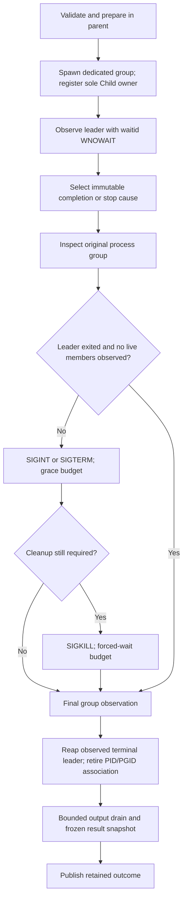

# Runner architecture and guarantee boundaries

The first stage separates command configuration, parent-side preparation,
Unix child ownership, byte capture, and supervision. `failforge-runner` exposes
`Runner`, `RunHandle`, configuration types, streaming chunks, and result types.
The CLI adds argument parsing, signal listeners, raw display, diagnostics, and
exit-code policy. Only Linux and macOS have process backends.

## Preparation and executable lookup

`CommandSpec::validate` checks structural input before any process is started.
The ordered checks cover the program, arguments, working directory, environment,
clear-environment/PATH context, timeout policy, and capture policy. Validation
does not prove that files exist or that an executable is accessible.

`Runner::start` requires an existing Tokio runtime with I/O and timers enabled.
Preparation and spawn are synchronous OS operations. Preparation canonicalizes
the child's effective working directory and builds its environment as a private
map: inherit unless `clear` is set, remove keys, then apply assignments. It never
changes the controller's global cwd or environment. Capture directories are
resolved against the controller's invocation directory.

A program containing `/` produces one candidate resolved against the child cwd.
A bare name produces candidates from the effective child `PATH`, in order.
Empty and relative entries refer to the child cwd. An absent `PATH` is an error,
with no fallback to the operating system's default executable search path.

Candidates are not preselected using executable permission bits: UID/GID rules,
ACLs, mount options, and changes between a check and execution can invalidate
such a decision. All candidate paths, argument C strings, environment C strings,
and null-terminated pointer arrays are prepared before fork. A `pre_exec` callback
attempts `execve` without allocation, formatting, or locking. Search continues
only after `EACCES`, `ENOENT`, or `ENOTDIR`. An exhausted search returns `EACCES`
if any candidate was denied; otherwise it returns the last lookup error.
`ENOEXEC` and other errors are returned immediately. This is FailForge's explicit
lookup contract, not a claim of identical platform-specific `execvp` behavior.

This explicit callback is necessary because the reviewed Rust Unix process
implementation normally calls `execvp`, whose unrecognized executable-header
behavior can invoke a shell. FailForge does not use that fallback. An explicitly
requested shell and a valid kernel-handled shebang remain supported. See
[Rust's Unix implementation](https://doc.rust-lang.org/src/std/sys/process/unix/unix.rs.html)
and [Linux exec(3)](https://man7.org/linux/man-pages/man3/exec.3.html).

Capture files are opened before spawn using exclusive creation, with mode
`0600`. Preparation is not a filesystem transaction: a failed second file open
or a later spawn failure can leave an already-created empty capture file. Existing
capture files are never silently overwritten. Parent filesystem operations are
synchronous and do not have a hard timeout.

## One owner from spawn to reap

After successful spawn, one private supervisor owns `ManagedChild`, which owns
the `std::process::Child`. The caller receives a `RunHandle`, not a `Child` or a
supervisor `JoinHandle`. The supervisor is registered before `start` returns.

Each child starts in a dedicated process group with PGID equal to its initial
PID. Its stdout/stderr read descriptors move once into capture readers. The
controller's stdout/stderr file-description flags are not changed.

The ownership lifecycle is:

Observation uses `waitid(P_PID, ..., WEXITED | WNOHANG | WNOWAIT)`. It reports
termination without consuming the child's status. The unreaped leader reserves
its PID while group operations are still needed. `Child::try_wait` is therefore
not used by the normal lifecycle: on Unix it would reap a completed child.
The supervisor calls `Child::wait` only after a terminal exit has been observed,
and after the last group signal and observation. The native `ExitStatus` is
retained, including a real exit code or signal. After reap, no later numeric
PID/PGID signal is permitted. [Rust Child documentation](https://doc.rust-lang.org/std/process/struct.Child.html)
and [Linux waitid(2)](https://man7.org/linux/man-pages/man2/waitid.2.html) describe
the relevant wait semantics.

Before each group signal, another non-reaping observation verifies that the
leader is still an owned, waitable child. `ECHILD` permanently retires the
association; it is not interpreted as successful reap. The embedding application
must not reap FailForge's children independently or change SIGCHLD to `SIG_IGN`
or `SA_NOCLDWAIT` while a run is active. Spawn rejects those status-discarding
dispositions when already installed. No global SIGCHLD disposition is changed.

Tokio is used for scheduling, timers, readiness, and notifications. The actual
child owner is a standard-library `Child`, not `tokio::process::Child`; no Tokio
child wrapper is registered for the same PID. The audited Tokio version is
**1.53.2**, whose orphan reaper operates on the children it owns rather than
globally waiting for arbitrary child PIDs. Its fetched crate source,
`tokio-1.53.2/src/process/unix/orphan.rs`, was reviewed against the lockfile.
[Tokio orphan source documentation](https://docs.rs/tokio/latest/src/tokio/process/unix/orphan.rs.html)
shows the mechanism; its `latest` URL may change with future releases.

## Group census and cleanup evidence

`kill(-pgid, 0)` alone cannot establish absence of live group members, because
zombies can retain group membership and signal checks do not report per-member
state. The backend instead performs a bounded process census before retiring
the association:

| Platform | Census |
| --- | --- |
| Linux | Read `/proc/PID/stat`, identify the process group, and distinguish `Z` zombies from live states; dead `X`/`x` records are ignored |
| macOS | `proc_listpids(PROC_PGRP_ONLY)` followed by `proc_pidinfo(PROC_PIDT_SHORTBSDINFO, arg=1)` to include zombie information |

Both paths bound their census to 65,536 PID entries. Linux bounds individual stat
records to 16 KiB and mount information/self status to 1 MiB. It verifies the opened
`/proc` mount, rejects restricted `hidepid` visibility, and requires one positive
`NStgid` column matching the controller's native PID. Multiple columns expose a
procfs mounted in an ancestor PID namespace, even if numeric IDs happen to
coincide; missing or malformed namespace evidence yields an unknown census rather
than treating differently numbered or invisible processes as absent. macOS grows
its native PID buffer within the same cap and
rejects full/truncated or malformed results. Both verify the group reported for
each candidate and treat query failures conservatively.

Two consecutive snapshots with no live members and the same zombie PID set
yield `NoLiveMembers { zombies }`. A changing zombie set yields `Unknown`.
`LiveMembers` and `Unknown` remain distinct from completion. These are bounded
observations of the original group, not an atomic proof about every descendant.
The final `CleanupReport` records child reap, the group observation, signal
attempts, errors, and output completion separately.

`CleanupReport::is_complete()` requires all of the following:

- The direct child was actually reaped.
- The original group had no live members observed before its association retired.
- Output reached EOF and capture writers finished without an issue.
- Cleanup recorded no errors.

Zombies counted in the observed group are not running processes. FailForge reaps
its own direct child; a descendant's other parent or the OS must reap that
descendant. The census can therefore report no live members while zombie records
still exist.

Apple behavior was reviewed against XNU **12377.121.6**, commit
`ac9718fb1af618d5ce8678d0dc6e8a58f252216f`: [waitid/WNOWAIT implementation](https://github.com/apple-oss-distributions/xnu/blob/ac9718fb1af618d5ce8678d0dc6e8a58f252216f/bsd/kern/kern_exit.c#L3065)
and [process enumeration and zombie lookup](https://github.com/apple-oss-distributions/xnu/blob/ac9718fb1af618d5ce8678d0dc6e8a58f252216f/bsd/kern/proc_info.c#L339).
Native declarations come from pinned **libc 0.2.190**; ABI layouts are not
recreated as handwritten structures. [Linux proc_pid_stat(5)](https://man7.org/linux/man-pages/man5/proc_pid_stat.5.html)
describes the Linux state/group fields, [proc_pid_status(5)](https://man7.org/linux/man-pages/man5/proc_pid_status.5.html)
describes namespace-relative ID columns, and [proc(5)](https://man7.org/linux/man-pages/man5/proc.5.html)
describes restricted process visibility.

## Stop decisions, cancellation, and accounting

The supervisor polls at a 5 ms interval and freezes one stop decision. Within a
poll, precedence is observed completion, an accepted cancellation request,
capture failure, then an elapsed execution timeout. This gives a defined tie
policy; it does not claim to reconstruct which event happened first between
polls. An output/setup error may prevent normal-completion selection, and later
cleanup/capture errors still turn the outcome into a partial failure without
rewriting the chosen cause.

The first accepted cancellation reason is retained. A force request can shorten
the grace period without changing that reason. Ctrl+C cancellation begins with
SIGINT; other cancellation and timeout paths use SIGTERM. SIGKILL follows if the
leader/group still requires cleanup. Ordinary completion also cleans live group
members left behind by a completed leader.

Forced termination additionally addresses the sole owned leader by its pinned
positive PID if it is still alive, because the leader may have left its original
group. The backend never adopts or signals the leader's new group. A failed
original-group signal remains an error even when the direct-leader route succeeds.

`RunHandle::wait` reads a retained shared outcome. Dropping a wait future does
not abort supervision or consume the result; another wait can return the same
outcome. Dropping the handle requests cancellation. Dropping `Runner` requests
shutdown but cannot synchronously await it. Applications should call
`Runner::shutdown().await` while their runtime remains available.

Shutdown closes admission, requests cancellation for registered runs, and waits
within the cleanup/drain budget. A budget expiration publishes an honest partial
result instead of claiming cleanup succeeded. If leader exit has not arrived,
the supervisor keeps the sole child owner and its registry entry until eventual
reap; returning a partial result does not transfer wait ownership to a caller.
Registry admission and retained unobserved failures are capped at 64 records.
Waiting acknowledges an outcome; acknowledgement does not erase incomplete
cleanup evidence or make unfinished resources disappear. Shutdown can therefore
report incomplete active runs or retained cleanup failures.

Execution, graceful termination, forced wait, and output drain have separate
budgets. Execution timing starts after successful spawn. `RunTimings` reports
preparation, spawn, execution, cleanup, and output drain separately. Huge budgets
that cannot be represented as clock deadlines are rejected before spawn.
None of these timers promises a hard real-time bound on arbitrary blocking OS
or filesystem operations.

## Bounded byte capture and blocking sinks

Separate Tokio `AsyncFd` readers handle stdout and stderr concurrently. They
read bytes without line buffering or UTF-8 conversion and explicitly yield so a
continuously readable pipe cannot starve supervisor timers. Each stream owns a
fixed-capacity tail. Empty tails, queues, and file quotas are supported according
to their configured sizes; the read chunk must be positive.

Default bounds are a 32 KiB read buffer, a 1 MiB retained tail per stream, a 1 MiB
combined display queue, and a 256 MiB capture-file quota per stream. Each capture
file also has a byte queue bounded to twice the read-chunk size, including a
chunk currently being written. Resident memory is tied to these policy limits,
the number of admitted runs, and bounded snapshots, rather than total output
volume. Allocator, OS pipe, filesystem cache, runtime, and executable memory are
outside those application-buffer limits.

Optional file capture uses dedicated standard OS threads, outside Tokio's
blocking pool. A global permit caps these threads at **eight**, including threads
that outlive a drain deadline. A blocked writer retains its permit until the
actual OS thread returns, so later runs cannot grow an unbounded population of
blocked writer threads. Queue backpressure can stop a file reader from reading;
the independent supervisor can still select timeout/cancellation and signal
the managed group.

Read errors, file write errors, exhausted quotas, counter overflow, and premature
worker termination are explicit capture issues. A file quota limits accepted
capture bytes; reaching EOF at exactly the quota is valid. Excess bytes cause a
partial run failure. Actual file-write counters advance only after successful
writes. These counters do not imply `fsync` durability.

Streaming is separate from capture. One shared byte budget covers queued
stdout/stderr chunks **and all consumer-held in-flight chunks**. A chunk's
`mark_displayed` acknowledges bytes actually written, including partial writes;
dropping unacknowledged bytes accounts them as dropped display. A full queue or
lost receiver discards display chunks without disabling capture. Display write
errors explicitly request a partial failure through `StreamChunk::report_error`.
The chunk records its immutable original stream, even if a consumer changes its
public display routing label or receives several chunks before writing them.
For an error without a chunk, `StreamReceiver::report_error(stream, error)`
requires an explicit `OutputStream`; it never guesses the latest received stream.

Each file reader owns a producer guard constructed before its task future is
created. Dropping that future closes the file queue on normal completion,
panic, or cancellation, including cancellation before the first poll. Accepted
file chunks remain available for the writer; independent drain expiration can
still discard pending work and detach a genuinely blocked filesystem operation.

The CLI displays on a dedicated OS thread and does not join a potentially
blocked terminal write during runtime shutdown. Its diagnostic thread likewise
uses a bounded 64-message queue and bounded messages, with a short final-delivery
acknowledgement budget. Blocking controller stdout/stderr cannot consume Tokio's
blocking pool indefinitely. Delivery of diagnostics is best effort; a blocked
stderr may prevent the final summary from appearing.
For inherited nonblocking stdout/stderr, a display `WouldBlock` waits for native
writable readiness on that dedicated thread and retries. Partial writes advance
acknowledgements only by actual bytes written. The CLI preserves shared descriptor
flags, and closed/broken sinks still produce explicit failures.

Output drain has its own budget. After it expires, readers are aborted, queued
file/display bytes are closed or discarded, and finished threads may be joined.
An unfinished file thread is detached with its global permit retained. An
in-flight terminal write cannot safely be interrupted; its bytes may remain
unconfirmed in the returned snapshot. No total ordering across stdout/stderr is
promised, although each stream's accepted bytes remain ordered.

Results contain frozen snapshots. A detached OS operation can finish later,
and a file may receive an in-flight write after a drain-expired snapshot; the
returned counters/status are not retroactively rewritten. An incomplete writer
or unread output is reported explicitly rather than treated as complete capture.
Raw tails, capture files, and streaming data may contain secrets; only normal
diagnostics omit raw arguments/environment/output.

## Runtime destruction and other limits

An active supervisor has a last-resort owned-child drop guard. It attempts an
owned group kill and hands the direct child to one background reaper thread,
with at most 128 pending and 128 queued children and a five-second reap budget.
The guard never performs an unbounded wait in `Drop`, and it does not use numeric
group IDs after reap or lost association. Queue exhaustion or OS failure is
best effort, not successful cleanup evidence.

Normal operation relies on retaining the supervisor through reap and explicit
shutdown, not on this fallback. Runtime destruction, task abort, process panic
with abort, and SIGKILL of the controller cannot provide the normal lifecycle's
cleanup guarantee. Process groups also permit escape: a descendant creating
another process group/session is outside the original group's observation and
signals. FailForge neither contains such a descendant nor claims to be a
security boundary.

## Verification and reproducibility

The minimum verification toolchain is **Rust 1.85.1**. Stable CI is a separate
moving check. The Unix source review used **Rust 1.99.0**, compiler revision
`b940084d7` dated 2026-09-28; the canonical Rust documentation links above are
moving URLs and must be rechecked after a compiler upgrade. Dependency behavior and
FFI declarations are pinned to **Tokio 1.53.2** and **libc 0.2.190** in the lockfile.
Source review informs ownership decisions; it does not replace executable
lifecycle tests on each supported platform.

The automated suite covers structural contracts, native arguments/environment,
output boundaries, return codes, cancellation, and group-cleanup scenarios with
the Rust fixture. Fixture control channels are independent of captured pipes;
tests use external deadlines and control-based cleanup rather than readiness
sleeps. Stable and MSRV jobs are configured for Linux and macOS. Configuration
alone is not a claim that those jobs have run or passed.

See [the build and verification commands](../README.md#build-and-verify),
[the benchmark driver](../scripts/benchmark.py), and [the CLI contract](cli.md)
for reproducible checks, measurement tooling, and user-visible behavior. Record
the environment, build, commands, and workload alongside results. Coverage
numbers and benchmark results describe that recorded build/workload; no
line-coverage or universal cleanup/performance percentage is inferred from a
test count.

## Dart adapter extension

`failforge-dart` reuses this Runner for a persistent, bounded JSON Lines session.
`Runner::start_with_stdin` transfers a caller-owned descriptor; `start` retains
null stdin. The adapter client owns its protocol endpoints and a RunHandle, while
the same existing supervisor remains the only child owner. Stream consumers can
observe `StreamReceiver::dropped_bytes` and reject incomplete protocol data.
Cancelled request futures poison client reuse, and closing one client does not
shut down other runs admitted by the shared Runner.

The adapter's syntax/type analysis and safe-patch contract are described in the
[Dart adapter guide](dart-adapter.md). The repository still has no production
snapshot/workspace manager, mutation scheduler, YAML/profile normalization or
mutation score orchestration. The executable Flutter fixture harness demonstrates
these integration steps on test copies without claiming to implement those core
services.
